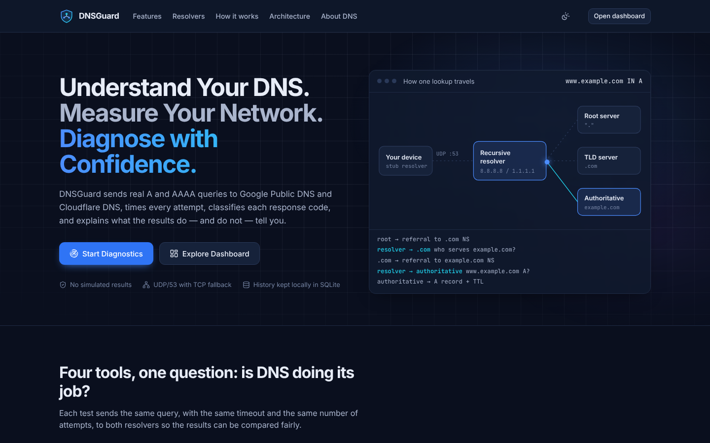
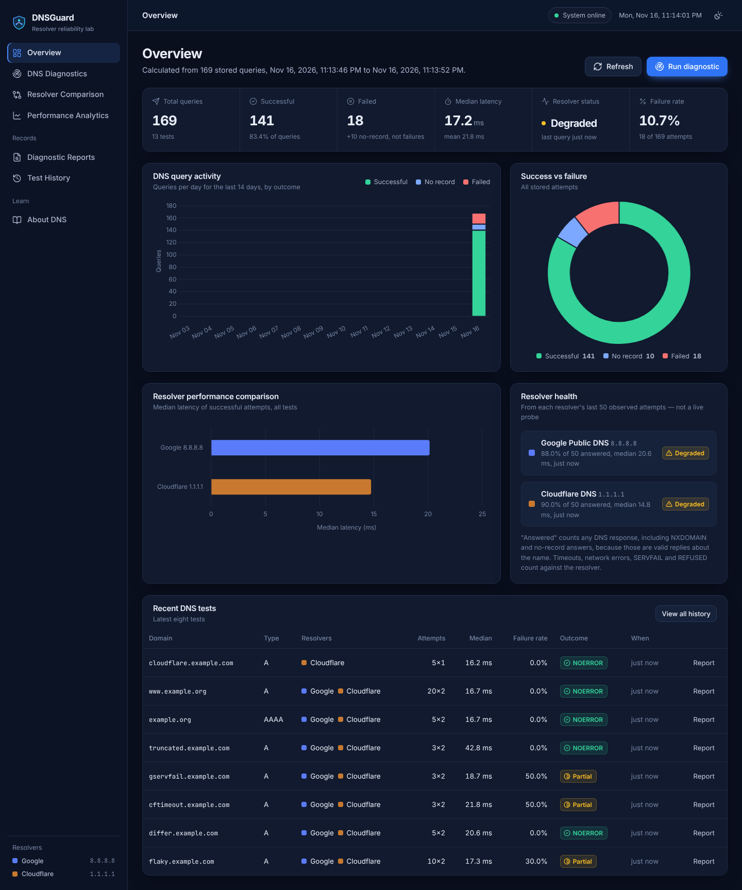
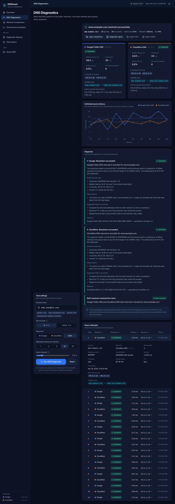
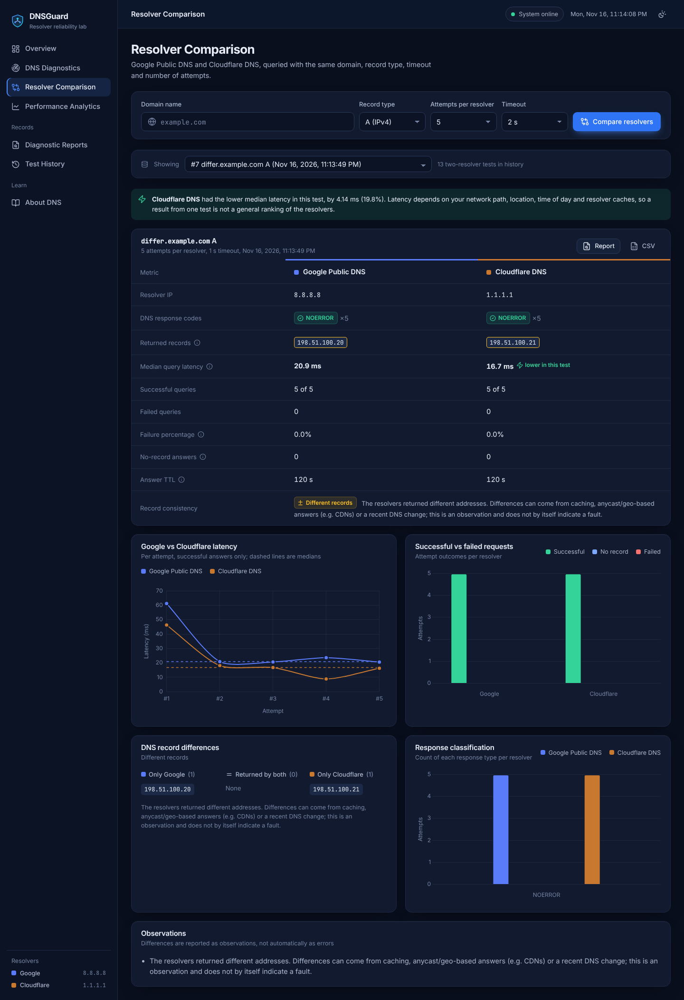
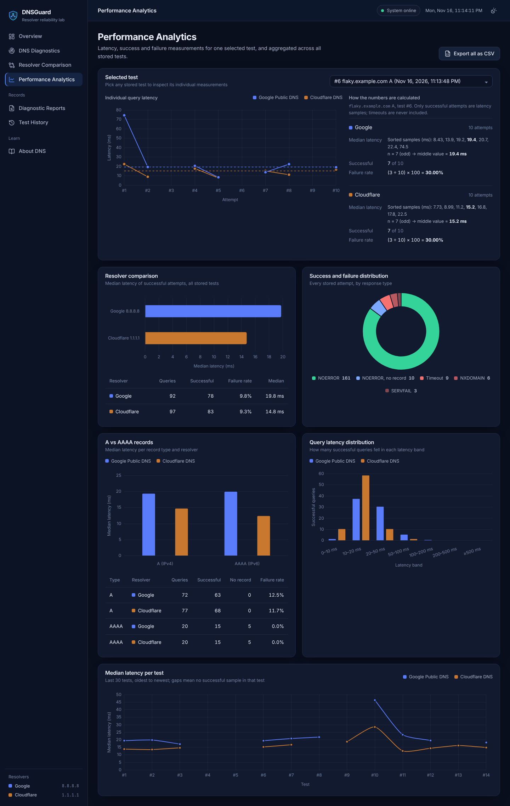
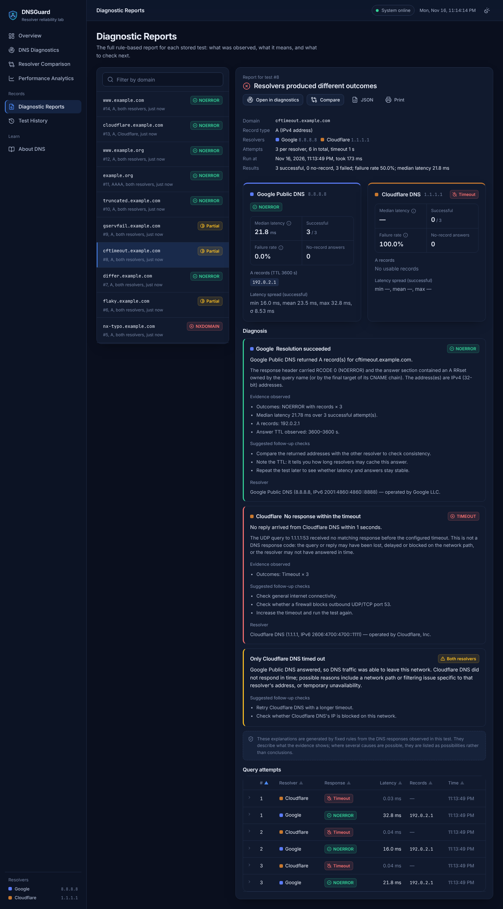
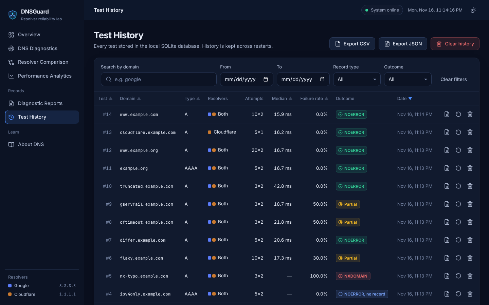
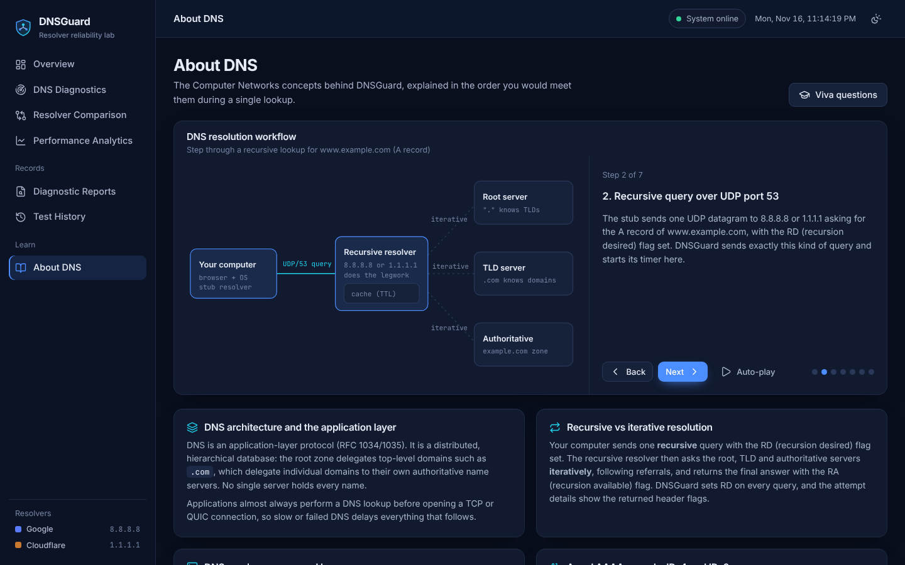
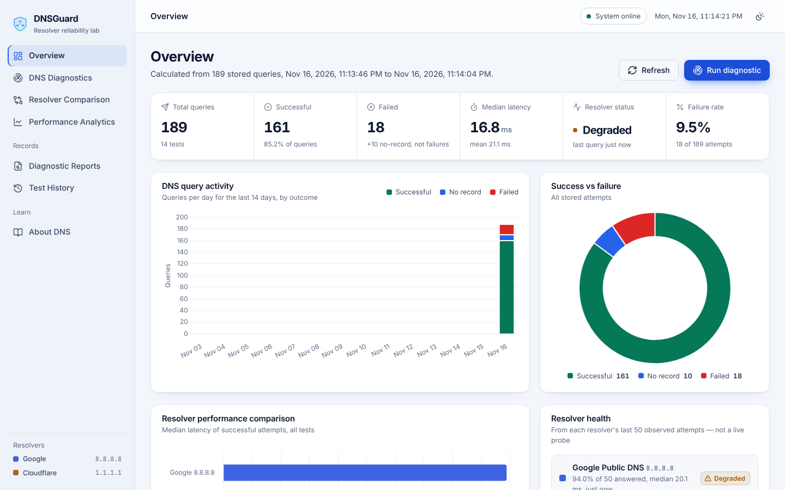
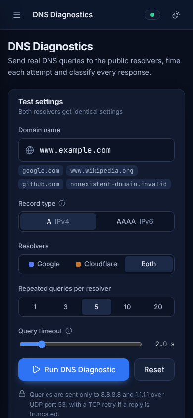

# DNSGuard – DNS Diagnostics and Resolver Reliability Analysis System

DNSGuard is a Python and Flask web application that sends **real DNS queries** to **Google Public DNS (8.8.8.8)** and **Cloudflare DNS (1.1.1.1)**. It measures the latency of every attempt, classifies each response code, compares the two resolvers and explains the outcome with fixed diagnostic rules. Test history is kept in SQLite.

> Computer Networks project, B.Tech CSE, third year, semester 5.
> Department of CSE & IT, Jaypee Institute of Information Technology, Sector-62, Noida.



---

## Contents

1. [Problem statement](#problem-statement)
2. [Objectives](#objectives)
3. [Technology stack](#technology-stack)
4. [Features](#features)
5. [System architecture](#system-architecture)
6. [DNS working principle](#dns-working-principle)
7. [Module explanations](#module-explanations)
8. [Measurement definitions](#measurement-definitions)
9. [Installation and running](#installation-and-running)
10. [Running the automated tests](#running-the-automated-tests)
11. [Project directory structure](#project-directory-structure)
12. [API endpoints](#api-endpoints)
13. [Security](#security)
14. [Screenshots](#screenshots)
15. [Limitations](#limitations)
16. [Future scope](#future-scope)
17. [Team](#team)
18. [References](#references)

---

## Problem statement

Ordinary lookup tools (`nslookup`, `dig`) retrieve records one at a time. Comparing two resolvers over repeated queries means running separate commands, copying results by hand and interpreting raw output. A single response time says nothing about typical performance or how often queries fail.

DNS error codes also need care. **NXDOMAIN** means the name does not exist. **NOERROR with no requested record** means the name exists but has no record of that type. **SERVFAIL** and **timeouts** are different observable outcomes and must not be lumped together. DNSGuard queries both resolvers the same way, calculates simple reliability statistics, and explains each outcome without claiming causes that the evidence cannot establish.

## Objectives

- Resolve user-supplied domains with DNS **A** and **AAAA** queries.
- Compare responses from Google Public DNS and Cloudflare DNS.
- Measure per-query response time, **median latency** over repeated queries, **successful query count** and **failure rate**.
- Distinguish NOERROR (with records), NOERROR without the requested record, NXDOMAIN, SERVFAIL, REFUSED, other codes and timeouts.
- Provide a **rule-based diagnostic module** that explains observed outcomes and suggests follow-up checks.
- Visualise records, comparisons and measurements in a Flask dashboard.
- Store test history in **SQLite** (implemented: history survives restarts).

## Technology stack

| Layer | Technology |
|---|---|
| Backend | Python 3.11+, Flask 3, dnspython 2 |
| Concurrency | `concurrent.futures.ThreadPoolExecutor` (one worker per resolver), background job threads |
| Storage | SQLite (`sqlite3`, parameterised queries), JSON serialisation |
| Frontend | HTML5, CSS3 (custom design system, no Bootstrap), ES6 JavaScript |
| Charts and icons | Chart.js 4, Lucide icons (both vendored in `static/vendor`, so the app works offline) |
| Typography | Inter, plus JetBrains Mono for addresses and protocol data (vendored WOFF2 files) |
| Testing | pytest, Flask test client, mocked DNS transport |

No Node.js, React or other database is needed at runtime.

## Features

| Area | What it does |
|---|---|
| **Landing page** | Hero with an animated recursive-resolution trace, feature overview, live resolver preview built from your own stored data, how-it-works steps, architecture overview and project footer. |
| **Overview dashboard** | Total, successful and failed queries, median latency, resolver status and failure rate. Also: a 14-day activity chart, success vs failure doughnut, resolver latency comparison, resolver health from recent observations, and recent tests. |
| **DNS Diagnostics** | Domain input with validation, A/AAAA, Google/Cloudflare/Both, 1/3/5/10/20 attempts, timeout slider (0.5–10 s). Shows real progress per completed query, resolver result cards (records, CNAME chain, TTL, latency spread), a latency chart, the diagnosis, and a sortable table with expandable rows for every attempt. |
| **Resolver Comparison** | Side-by-side metrics, the lower median latency in this test (with an explicit caveat), record-set differences (only Google / both / only Cloudflare), outcome and response-classification charts, and observations. |
| **Performance Analytics** | Per-test latency line chart with a **worked calculation** (sorted samples → median, failed ÷ total × 100). All-time resolver comparison, response distribution, A vs AAAA comparison, latency histogram and per-test median trend. |
| **Diagnostic Reports** | Searchable list of stored tests and a full printable report for each: evidence, observations, follow-up checks, cross-resolver findings and a disclaimer. |
| **Test History** | Search by domain, filter by date, record type and outcome, server-side sorting, pagination, re-run, delete with confirmation, clear history with confirmation, export CSV/JSON (all tests or one test). |
| **About DNS** | Interactive step-through diagram of recursive resolution, concept explanations (architecture, recursion, A/AAAA, IPv4/IPv6, UDP/TCP fallback, timeouts, latency, caching/TTL, reliability), an RCODE table and viva questions. |
| UI | Dark-first theme with a light theme toggle, responsive layout with mobile navigation, toasts, custom tooltips, confirm dialogs, skeleton loaders, empty and error states, keyboard focus styles, and reduced-motion support. |

## System architecture

```
Browser (templates + static/js)
   │  fetch() JSON, X-CSRF-Token header
   ▼
Flask app (app.py) ── routes/main_routes.py      HTML pages
   │                └ routes/dns_routes.py       /api/dns/*, /api/dashboard, /api/analytics
   │                └ routes/history_routes.py   /api/history/*
   ▼
services/  runner.py  ── orchestrates one test (flow chart in the synopsis)
           jobs.py    ── background job + progress for the UI
           security.py── CSRF, rate limit, security headers
   │
   ├──► dns_engine/  validation.py ─ input validation and resolver allow-list
   │                 resolver.py   ─ the two configured resolvers
   │                 query_handler.py ─ dnspython UDP query, TCP fallback, perf_counter timing
   │                 response_classifier.py ─ RCODE / NODATA / CNAME-chain classification
   │                 performance.py ─ median, failure rate, comparison
   ├──► diagnostics/diagnostic_engine.py ─ fixed if/else rules → explanations
   └──► database/   db.py (schema, connections) · history.py (save, query, export, aggregates)
                         │
                         ▼
                   instance/dnsguard.db (SQLite)
```

One test runs through these steps:

1. Validate input (domain, type, resolvers, attempts, timeout).
2. Query each resolver *n* times with identical parameters. Resolvers run in parallel; attempts to the same resolver run one after another.
3. Classify each response.
4. Calculate statistics and compare the resolvers.
5. Apply the diagnostic rules.
6. Save the test and every attempt to SQLite.
7. Return JSON to the UI.

## DNS working principle

1. An application asks the operating system's **stub resolver** for a name.
2. The stub sends a **recursive query** (RD flag set) over **UDP port 53** to a recursive resolver such as 8.8.8.8.
3. On a cache miss, the resolver asks the **root** server, which refers it to the **TLD** servers (e.g. `.com`). The TLD servers refer it to the domain's **authoritative** servers, which return the answer. This part is **iterative resolution**.
4. The resolver **caches** the answer for its **TTL** and returns it with a response code (**RCODE**).

DNSGuard performs step 2 directly with dnspython and observes the result of steps 3–4: records, RCODE, flags, TTL and latency. If a UDP reply is **truncated** (TC flag), the query is repeated over **TCP port 53**. The About DNS page in the app explains all of this interactively.

## Module explanations

| Module | Responsibility |
|---|---|
| `config.py` | Single place for the resolver allow-list, allowed record types and attempts, timeout limits and app settings (env-driven secrets). |
| `dns_engine/resolver.py` | `ResolverEndpoint` objects for Google and Cloudflare. Clients can only name a resolver key, never an IP. |
| `dns_engine/validation.py` | Normalises and validates input: IDNA, label rules, 253-character limit, rejects IPs and URLs (extracts the host from URLs), bounded attempts and timeout. |
| `dns_engine/query_handler.py` | Builds a DNS message (`RD=1`, EDNS0 payload 1232) and sends **one** UDP exchange per attempt with `dns.query.udp`. Retries over TCP on truncation and times the exchange with `time.perf_counter()`. Converts timeouts, socket errors and malformed replies into classified failures. Transport functions and the clock are injectable for testing. |
| `dns_engine/response_classifier.py` | Maps the response to `SUCCESS`, `NOERROR_NODATA`, `NXDOMAIN`, `SERVFAIL`, `REFUSED`, `OTHER_ERROR`, `TIMEOUT` or `NETWORK_ERROR`. Follows the CNAME chain and only accepts A/AAAA records owned by the final name, so a CNAME-only answer is never mistaken for a success. |
| `dns_engine/performance.py` | Median (successful samples only), failure rate, min/mean/max/σ, record-set consistency and resolver comparison. A latency difference under 0.5 ms is reported as a tie. |
| `diagnostics/diagnostic_engine.py` | A rule table per outcome (status, simple and technical explanation, follow-up checks). Adds per-resolver evidence and observations (CNAME, IPv6 absence, TCP fallback, load balancing, a possible cache miss) and cross-resolver rules (e.g. both NXDOMAIN, only one timed out). States uncertainty where several causes are possible. |
| `database/db.py`, `database/history.py` | Schema (`tests`, `query_attempts` with `ON DELETE CASCADE`), saving, filtered listing, detail, delete, clear, CSV/JSON export (with spreadsheet-formula neutralisation), dashboard and analytics aggregates. |
| `services/runner.py` | Runs one complete test (engine → comparison → statistics → diagnosis). |
| `services/jobs.py` | Background jobs so the UI can show true progress (completed queries / total). |
| `services/security.py` | CSRF tokens, per-IP rate limiting and security headers (CSP, nosniff, frame denial). |
| `routes/*` | Thin HTTP layer with consistent JSON responses: `{"ok": true, "data": …}` or `{"ok": false, "error": {"code", "message", "field"}}`. |
| `static/js/main.js` | Shared client library: API client, escaping, formatting, toasts, dialogs, tooltips, theme, shared renderers and chart helpers. |

## Measurement definitions

These follow the synopsis exactly.

| Measure | Definition |
|---|---|
| Query response time | Elapsed `perf_counter()` time from sending the query to receiving the reply, in ms. |
| **Successful attempt** | RCODE NOERROR **and** at least one A/AAAA record owned by the query name (or the final CNAME target). |
| **Median latency** | Median of the response times of **successful attempts only**. Timeouts, error responses and no-data answers are never latency samples. With no successful samples the median is reported as unavailable. |
| **Failed attempt** | A classified DNS error (NXDOMAIN, SERVFAIL, REFUSED, other RCODE, malformed reply) or no response (timeout, network error). |
| **Failure rate** | `(failed attempts / total attempts) × 100`. |
| No-record answer | NOERROR without the requested record type. It is neither a success nor a resolver failure, so it is reported separately: `successful + no_record + failed = total`. |
| Record consistency | Compares the union of returned addresses per resolver: identical, overlapping, different, or not comparable. Differences are observations, not errors. |
| Resolver health (dashboard) | Share of each resolver's last 50 stored attempts that received any DNS answer. Timeouts, network errors, SERVFAIL and REFUSED count against the resolver; NXDOMAIN and no-record answers are valid replies. This is clearly labelled as historical observation, not a live probe. |

## Installation and running

Prerequisites: **Python 3.11 or newer**, and outbound UDP/TCP port 53 to 8.8.8.8 and 1.1.1.1 for real tests.

### Windows (PowerShell)

```powershell
cd DNSGuard
python -m venv .venv
.\.venv\Scripts\Activate.ps1
# If activation is blocked: Set-ExecutionPolicy -Scope CurrentUser RemoteSigned
python -m pip install --upgrade pip
pip install -r requirements.txt
Copy-Item .env.example .env        # then set DNSGUARD_SECRET_KEY in .env
python app.py
```

### macOS / Linux

```bash
cd DNSGuard
python3 -m venv .venv
source .venv/bin/activate
python -m pip install --upgrade pip
pip install -r requirements.txt
cp .env.example .env               # then set DNSGUARD_SECRET_KEY in .env
python app.py
```

Open **http://127.0.0.1:5000**. The SQLite database is created automatically at `instance/dnsguard.db`.

To generate a secret key: `python -c "import secrets; print(secrets.token_hex(32))"`. If no key is set, a random one is generated at start-up, which only means sessions reset when the server restarts.

Quick real-network check from the command line:

```bash
python -m tools.integration_check
```

## Running the automated tests

The automated suite uses a **mocked DNS transport** (`tests/mock_dns.py`). It builds genuine `dns.message` responses with RFC 5737/3849 documentation addresses, so the tests are deterministic and need no internet.

```bash
# Windows PowerShell and macOS/Linux (inside the activated virtual environment)
python -m pytest -v
```

Real-network integration tests are skipped unless explicitly enabled:

```powershell
# Windows PowerShell
$env:DNSGUARD_NETWORK_TESTS = "1"; python -m pytest tests/test_integration_real.py -v
```

```bash
# macOS / Linux
DNSGUARD_NETWORK_TESTS=1 python -m pytest tests/test_integration_real.py -v
```

| File | Covers |
|---|---|
| `test_dns_engine.py` | Valid A and AAAA lookups, CNAME chains, CNAME-only and unrelated-owner answers (not success), NXDOMAIN, NOERROR without records, SERVFAIL, REFUSED, FORMERR, timeout, network error, TCP fallback, timing, RD/EDNS flags, identical parameters per resolver, allow-list. |
| `test_performance.py` | Median (odd/even/empty, cross-checked with `statistics.median`), failure-rate formula, timeouts and errors excluded from latency, no-sample handling, faster-resolver detection and ties, record consistency. |
| `test_diagnostics.py` | Every category has a complete rule, NXDOMAIN text matches the specification, NODATA is informational, SERVFAIL avoids claiming a single cause, one-sided timeout, intermittent failures, outcome labels, determinism. |
| `test_routes.py` | All pages, the response schema, invalid domain inputs (15 cases), parameter validation (11 cases), malformed JSON, 404/405 JSON errors, no stack traces, async jobs, CSRF, rate limiting, security headers, escaping. |
| `test_history.py` | Storage, retrieval, search/filters/dates, sorting allow-list (SQL injection attempt), pagination, delete with cascade, clear confirmation, persistence across restart, CSV/JSON export, CSV formula neutralisation, dashboard and analytics aggregates. |

**Recorded result (build machine):** `111 passed, 6 skipped` (the 6 skipped are the opt-in real-network tests).

## Project directory structure

```
DNSGuard/
├── app.py                     Flask application factory and entry point
├── config.py                  Resolver allow-list, limits, settings
├── requirements.txt
├── pytest.ini
├── .env.example
├── .gitignore
├── README.md
├── dns_engine/
│   ├── __init__.py
│   ├── resolver.py            Configured resolvers (allow-list)
│   ├── validation.py          Input validation and normalisation
│   ├── query_handler.py       dnspython queries, timing, TCP fallback
│   ├── response_classifier.py RCODE / NODATA / CNAME classification
│   └── performance.py         Median, failure rate, comparison
├── diagnostics/
│   ├── __init__.py
│   └── diagnostic_engine.py   Rule-based explanations
├── database/
│   ├── __init__.py
│   ├── db.py                  Schema and connections
│   └── history.py             History CRUD, export, aggregates
├── services/
│   ├── __init__.py
│   ├── runner.py              One complete test
│   ├── jobs.py                Background jobs with progress
│   └── security.py            CSRF, rate limit, headers
├── routes/
│   ├── __init__.py
│   ├── api_utils.py
│   ├── main_routes.py         HTML pages
│   ├── dns_routes.py          DNS / dashboard / analytics API
│   └── history_routes.py      History API
├── templates/
│   ├── base.html  layout.html  error.html  partials/logo.html
│   ├── index.html  dashboard.html  diagnostics.html  comparison.html
│   └── analytics.html  reports.html  history.html  about.html
├── static/
│   ├── css/style.css
│   ├── js/  main.js theme-init.js landing.js dashboard.js diagnostics.js
│   │        comparison.js analytics.js reports.js history.js about.js
│   ├── assets/favicon.svg
│   └── vendor/  chart.umd.min.js  lucide.min.js  fonts/ (Inter, JetBrains Mono) + licences
├── tests/
│   ├── conftest.py  mock_dns.py
│   ├── test_dns_engine.py  test_performance.py  test_diagnostics.py
│   ├── test_routes.py  test_history.py
│   └── test_integration_real.py   (opt-in, real network)
├── tools/
│   ├── integration_check.py   Real-network command-line check
│   └── mock_server.py         Mocked-DNS server used only for screenshots/offline demos
├── docs/
│   ├── API.md
│   └── screenshots/
└── instance/                  SQLite database lives here (created at run time)
```

## API endpoints

All JSON responses use `{"ok": true, "data": …}` or `{"ok": false, "error": {"code", "message", "field?"}}`. State-changing requests (`POST`, `DELETE`) need the `X-CSRF-Token` header from the page's `<meta name="csrf-token">`. Full request and response examples are in **[docs/API.md](docs/API.md)**.

| Method | Path | Purpose |
|---|---|---|
| GET | `/` `/dashboard` `/diagnostics` `/comparison` `/analytics` `/reports` `/history` `/about` | HTML pages |
| POST | `/api/dns/resolve` | Run a test (`domain`, `record_type`, `resolvers`, `attempts`, `timeout`, `async?`, `save?`) |
| POST | `/api/dns/compare` | Same as above, always both resolvers |
| GET | `/api/dns/jobs/<job_id>` | Progress and result of an async test |
| GET | `/api/dashboard/stats` | Totals, health, activity, per-resolver figures, recent tests |
| GET | `/api/analytics` | A vs AAAA, latency distribution, categories, per-test trend |
| GET | `/api/history` | List (`q`, `from`, `to`, `record_type`, `outcome`, `sort`, `order`, `limit`, `offset`) |
| GET | `/api/history/latest` | Most recent test with full detail |
| GET | `/api/history/<id>` | One test with attempts, comparison and diagnosis |
| DELETE | `/api/history/<id>` | Delete one test (cascades to its attempts) |
| DELETE | `/api/history` | Clear all; body must be `{"confirm": true}` |
| GET | `/api/history/export/csv` | CSV of all attempts, or `?test_id=` for one test |
| GET | `/api/history/export/json` | JSON of all tests and attempts, or `?test_id=` |
| GET | `/api/meta` | Resolvers, record types, attempt options, timeout limits |
| GET | `/api/status` | Application and database status |
| GET | `/api/diagnostics/rules` | The diagnostic rule table |

## Security

- **No open proxy or scanner:** only the two configured resolvers can be queried, chosen by key (`google`, `cloudflare`, `both`). Fields such as `resolver_ip` are rejected.
- Only A and AAAA queries. Attempts are limited to {1, 3, 5, 10, 20}, timeout to 0.5–10 s, and a test to at most 40 queries; there is a per-IP rate limit (30 tests/minute by default) and at most 4 concurrent background jobs.
- Domain validation (IDNA, label syntax, length) and safe handling of malformed JSON.
- Parameterised SQL everywhere. `LIKE` wildcards are escaped and sort columns come from an allow-list.
- XSS: Jinja autoescaping, `DG.esc()` on every dynamic value in JavaScript, and a strict **Content-Security-Policy** (`script-src 'self'`, no inline scripts).
- **CSRF** token required on every `POST`/`DELETE` to `/api/*`. Session cookie is `HttpOnly` and `SameSite=Lax`.
- No shell commands. Secrets come from the environment (`.env`, git-ignored). Stack traces are never returned; errors are logged server-side.

## Screenshots

> **How these were captured:** the build environment blocked outbound DNS (every query was intercepted locally), so these screenshots were taken with the test suite's **mocked DNS transport** (`tools/mock_server.py`). That is why every address is from the documentation ranges 192.0.2.0/24, 198.51.100.0/24 and 2001:db8::/32, and the latencies are artificial. When you run `python app.py` on a normal network, all data comes from real queries.

| | |
|---|---|
|  |  |
| Overview dashboard | DNS diagnostics result |
|  |  |
| Resolver comparison | Performance analytics |
|  |  |
| Diagnostic report | Test history |
|  |  |
| About DNS (interactive workflow) | Light theme |



## Limitations

- Results describe **this network, at this time**. Latency depends on the path to the nearest anycast instance, resolver caches and local conditions, so a single test does not rank the resolvers in general.
- Some networks intercept or redirect port-53 traffic. DNSGuard then measures the interceptor, not the public resolver. A sign of this is every name returning the same answer in under about 2 ms.
- Only A and AAAA records are queried, and only over IPv4 transport to 8.8.8.8 and 1.1.1.1 (the resolvers' IPv6 addresses are shown but not used).
- DNSSEC validation status (the AD flag) is not interpreted, and encrypted transports (DoH/DoT) are not measured.
- The diagnostic engine can only reason from what the resolver returned. It suggests checks (e.g. `dig +trace`) rather than performing authoritative-side investigation.
- Rate limiting and background jobs are in-memory, which suits a single-process deployment.

## Future scope

- More record types (MX, TXT, NS, CNAME, SOA) and DNSSEC (AD/CD flags, `+cd` comparison).
- DNS over HTTPS / DNS over TLS latency compared with plain UDP.
- Resolver IPv6 transport (2001:4860:4860::8888, 2606:4700:4700::1111) and more resolvers (Quad9, OpenDNS) behind the same allow-list.
- Scheduled monitoring with alerting, and percentile (p95/p99) latency over time.
- Iterative trace mode (root → TLD → authoritative) performed by DNSGuard itself.
- Evaluation of diagnostic classification accuracy against a hand-labelled test set, as suggested in the synopsis.


Third-party assets: Chart.js (MIT), Lucide (ISC), Inter and JetBrains Mono (SIL Open Font License). Licence files are in `static/vendor/`.
